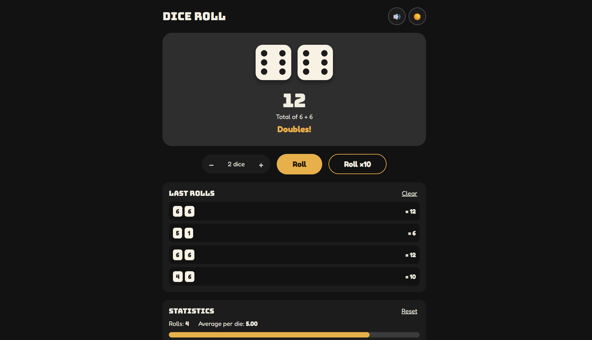
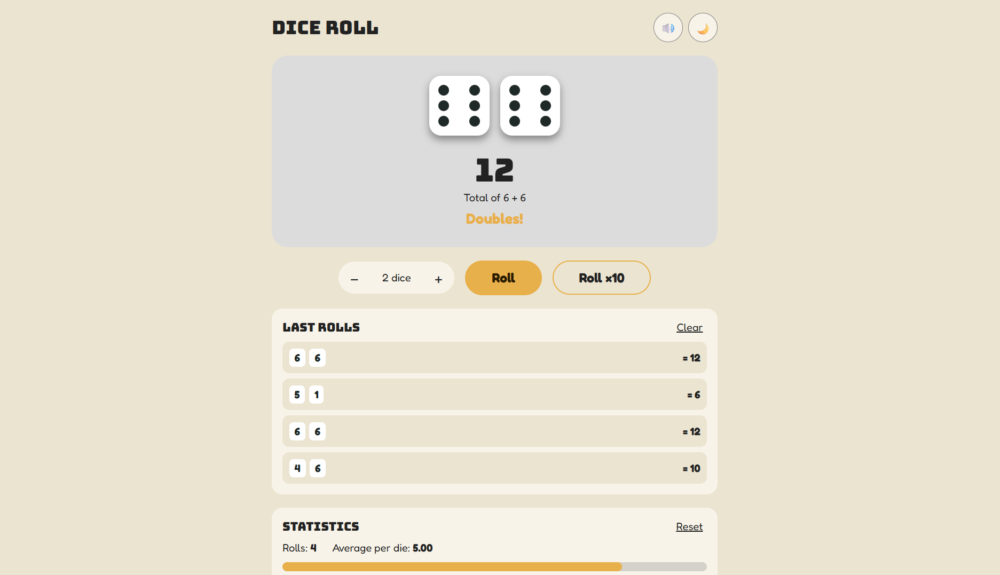

# Dice Roll

A smooth, responsive dice roller built with plain HTML, CSS and JavaScript. No frameworks, no build step.

**Live demo:** [Try Dice Roll](https://adityapc-cs.github.io/Dice_Roll/)

## Screenshots

### Desktop


### Mobile


## Features

**Core**
- Roll a six-sided die with a button click (result 1 to 6).
- Dice faces are drawn with CSS dots, not just numbers.
- Shake animation with changing faces before the final result lands.
- Roll two dice together and see the total.
- History of the last 10 rolls.
- Responsive layout for phones and desktops.

**Extras**
- Choose 1 to 6 dice.
- Sound effects with a mute button.
- Dark / light theme toggle.
- Statistics panel: number of rolls, average per die (with a smoothly animated bar), and a bar chart of how often each face came up.
- Press the Space bar to roll.
- **Roll ×10** button: rolls 10 times at once, adds up the total and saves every roll to the history and statistics.
- A "Doubles!" message when the dice match.
- History, dice count, theme and mute setting are remembered with `localStorage`.
- Works with the keyboard (Tab to move, Enter or Space to press buttons).

## Tech stack

- HTML5 for structure
- Google Fonts (Bungee and Fredoka), with Arial as the backup font when offline
- CSS3 (Flexbox, Grid, variables, keyframe animations, media query)
- Vanilla JavaScript (DOM, events, timers, Web Audio, `localStorage`)

## Project structure

```
dice-roll/
├── index.html   # page structure
├── style.css    # colours, layout, dice, animations
├── script.js    # random logic, DOM updates, history, sound, theme
└── README.md
```

## Setup

1. Clone the repo: `git clone <https://adityapc-cs.github.io/Dice_Roll/>`
2. Open `index.html` in any modern browser. That's it.

Optional: serve it locally with `npx serve` or the VS Code Live Server extension.

## How the randomness is generated

Each die value comes from this line:

```js
Math.floor(Math.random() * 6) + 1
```

- `Math.random()` gives a decimal from 0 up to (but not including) 1, with every value equally likely.
- Multiplying by 6 gives a number from 0 up to (but not including) 6.
- `Math.floor` cuts off the decimal, leaving 0, 1, 2, 3, 4 or 5.
- Adding 1 turns that into 1, 2, 3, 4, 5 or 6.

Each of the six faces gets an equal share of the range, so every face has a 1-in-6 chance. Testing 600,000 simulated rolls gave about 100,000 of each face.

The faces shown during the animation are only for show. The real result is generated once, when the animation ends.

## How it works (short version)

1. `createDice()` builds one die for each dice count, and each die has 9 dot spots.
2. `showFace(die, number)` turns on the dots listed for that number in `pipPatterns`.
3. `rollDice()` adds the `rolling` CSS class and swaps in random faces every 80 ms. After 900 ms `finishRoll()` picks the final numbers, shows the total and saves each roll to the history and statistics.
4. `showHistory()` redraws the history list from the saved rolls.
5. `addToStats()` counts each face, and `showStats()` updates the rolls, the average and the bar heights.

## Publishing to GitHub

```bash
git init
git add .
git commit -m "Add dice roll website"
git branch -M main
git remote add origin <your-repo-url>
git push -u origin main
```

Then turn on **Settings → Pages → Deploy from branch → main** for a free live link.
